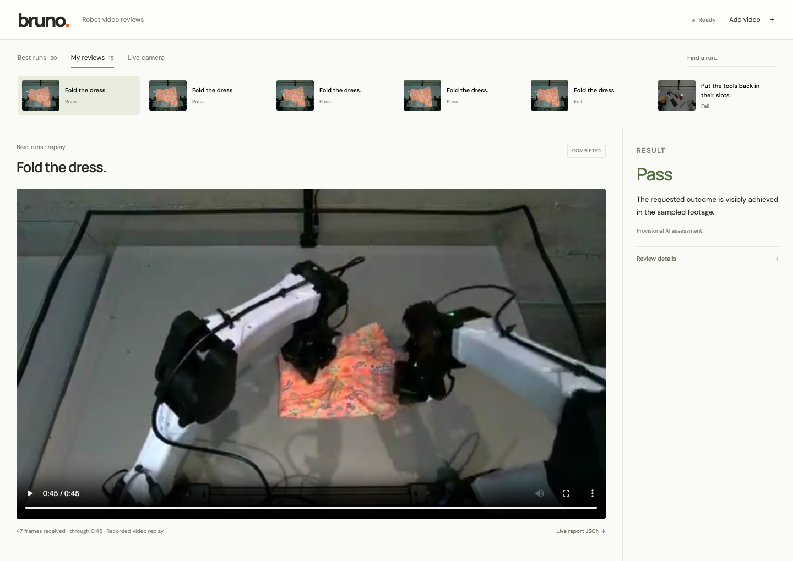
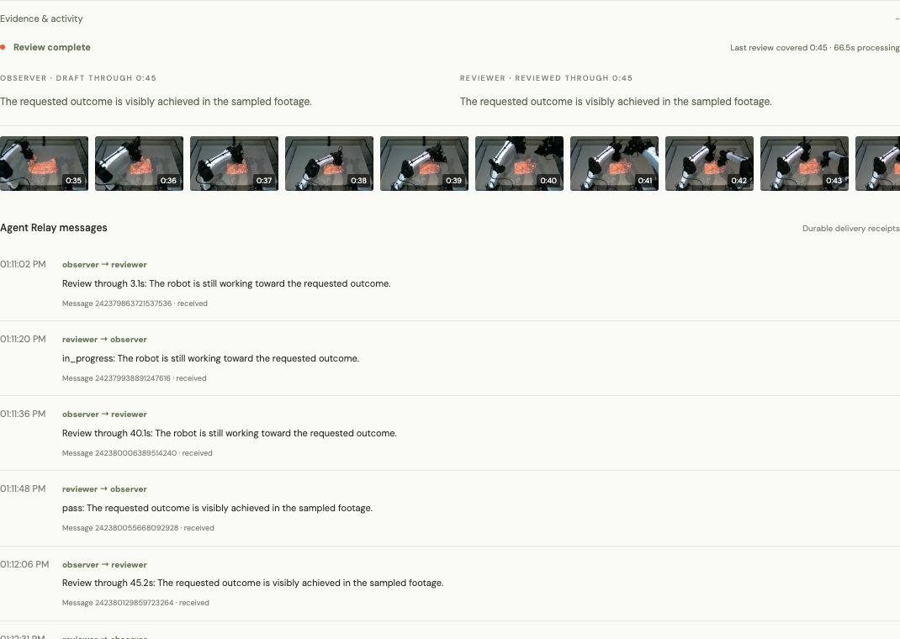
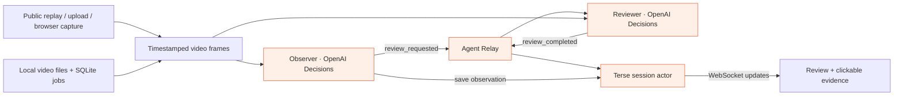

# bruno.

**Every robot run should come with evidence.**

Bruno reviews robot videos and shows you the frames behind its judgment. Give it a task and a recording. It watches for progress, checks whether the task got done, and keeps a review you can come back to.

Built at **Haunted Hacks: Real-Time AI Edition**, October 31, 2026, with **OpenAI, Terse, and Agent Relay**.

[Try it locally](#try-it-locally) · [How it works](#how-it-works) · [Sponsor integrations](#what-each-sponsor-tool-does) · [Measured results](docs/benchmarks.md) · [Demo script](docs/demo-script.md)



*Actual app, actual review. Robot footage: [Dream Labs public playground](https://dreamlabs.ai/playground/?clip=best154). This is a recorded replay.*

## Why I built it

A robot video can look promising and still leave you with a lot of questions. Did it finish? Did it recover after a mistake? Which moment explains the failure?

I wanted a first review that a robotics engineer could check, rather than another score to take on trust. Bruno keeps the task, the footage, the judgment, and the evidence together. You can click the timestamp and decide for yourself.

The first audience is engineers testing robot policies. The longer-term goal is to make reviewing a run as routine as running a test.

## The demo

The task is **“Fold the dress.”**

As the recorded run plays, the observer checks the frames received so far. A reviewer examines that evidence in a separate model request. Their messages travel through Agent Relay, and Terse saves the session as it changes.

The final fold is imperfect, but the requested outcome is visible. Bruno returns a provisional **Pass**. It does not invent requirements for perfect edges or a particular folding technique. If the footage cannot establish the answer, it can return **Uncertain**.

Open **Evidence & activity**, click a cited timestamp, then refresh the page. The review and its evidence are still there.



You can also upload your own video, record a browser tab, or evaluate an entire saved clip in the background. The public-camera connector waits for an available Dream Labs station; an active physical-camera run has not yet been verified.

## How it works



The observer gives you progress while the robot is still working. The reviewer checks the same images separately and can disagree. This is two application agents making separate model calls, not two trained robotics models.

Terse stores the task, frames, evaluation lease, saved model results, and delivery receipts. If the app restarts after a result is saved, it resumes the handoff from that checkpoint. Agent Relay carries the real messages between the two agent identities. [Read the architecture walkthrough →](docs/architecture.md)

## What each sponsor tool does

| Tool | Its job in Bruno | Where to look |
| --- | --- | --- |
| **[OpenAI](https://developers.openai.com/api/docs/guides/decisions)** | Decisions classifies each task condition and selects evidence frames using GPT-6 Luna. GPT-6.1 Sol through Responses is the fallback and the optional detailed-review mode. | [Evaluator](lib/decisions-evaluate.js), [rubric](lib/evaluation-policy.js) |
| **[Terse Durable Actors](https://docs.useterse.ai/quickstart)** | Each live run has a persistent session actor. It holds the review state, prevents overlapping claims, saves checkpoints, and streams updates to the browser. | [Actors](integrations/terse/src/actors.ts), [worker](lib/live.js) |
| **[Agent Relay](https://www.npmjs.com/package/@agent-relay/sdk)** | The observer sends a review request. The reviewer replies with its judgment. Durable inboxes, stable message keys, and delivery receipts make the handoff inspectable and recoverable. | [Relay integration](lib/relay.js) |

Dream Labs supplies the public footage used in this demo; Bruno is an independent project.

## What we measured

On the same 16-frame dress-folding window, with one observer call and one reviewer call:

| Evaluation route | Combined model-call time | Final judgment |
| --- | ---: | --- |
| GPT-6.1 Sol · Responses | 7.86 s | Pass |
| GPT-6 Luna · Decisions | **0.62 s** | Pass |

That's about **12.6× faster in this single matched check**. It compares two API/model routes; it does not isolate the endpoint from the model. The unfinished control returned **Fail**; an ongoing window returned **In progress**.

These are model-call timings, not end-to-end latency. In the browser test, observer calls took **0.22–0.71 seconds**, while reviewed windows took **30–67 seconds including Agent Relay handoff**. Faster model calls help, but transport is still a bottleneck. [Method, raw measurements, and reproduction instructions →](docs/benchmarks.md)

## Try it locally

You'll need **Node 22.16+**, **FFmpeg**, and an **OpenAI API key**. Node 24 is a good default.

```sh
git clone https://github.com/KaushikSiva/bruno-evals.git
cd bruno-evals
npm ci
cp .env.example .env.local
chmod 600 .env.local
```

Set `OPENAI_API_KEY` in `.env.local`, then:

```sh
npm start
```

Open **http://127.0.0.1:5190**, choose **Best runs → Fold the dress**, and click **Evaluate**. Terse runs locally on port 7100. The app creates its Agent Relay workspace on first start. New AI reviews use API credits.

This is a local development app. Public hosting needs authentication and a configured actor deployment. See the [runbook](docs/runbook.md) for recording, imports, saved files, configuration, and recovery.

## What this can—and can't—tell you

Bruno judges visible task completion. Sampled images can miss motion, hide contact, or leave the ending unclear. A visual pass is not a safety certification, and agreement between two calls is not ground truth.

Public gallery clips are selected examples, so their pass rate is not a model benchmark. Publisher scores are withheld from the evaluator. Decisions produces short, fixed-wording explanations with selected evidence pointers; detailed prose remains available through Responses.

The live-camera connector is implemented and tested against controlled fixtures. The public station was offline during our check, so the demo uses clearly labeled recorded footage.

## Build with us

The next useful work is better evidence selection, a human-labeled evaluation set, faster message delivery, and a verified live-camera run. [The roadmap](docs/roadmap.md) separates those plans from what works today.

If you have a robot run Bruno gets wrong, that is a useful contribution. Open an issue with the task, the expected outcome, and a clip you have permission to share. Please leave credentials and private footage out of issues. [Contributing guide →](CONTRIBUTING.md)

```sh
npm test
# Optional, with the local app running; spends API credits:
node scripts/verify-live.js --clip=dream-best-154
```

Built by [Kaushik Sivakumar](https://github.com/KaushikSiva). If Bruno would help your robotics work, a star helps other builders find it.
