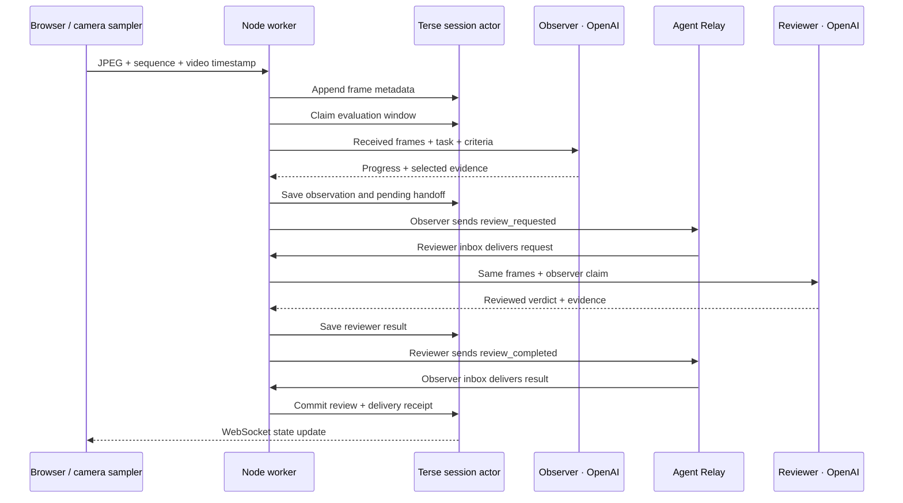

# How a run moves through Bruno

The main idea is simple: the video, the model's opinion, and the review state have different jobs. Keeping them separate makes a judgment easier to inspect and a failed handoff easier to recover.

## The three paths

**Live review of a recorded run.** The browser plays a public clip and sends about one JPEG per second. The observer only receives frames that have arrived. Having the full MP4 on disk does not give that request access to future frames.

**Browser capture.** The user chooses a tab or window through the browser's capture picker. Bruno reviews sampled frames during capture. When recording stops, the full recording is saved and queued for a separate whole-video review.

**Whole-video review.** A background job saves the source, hashes its bytes, creates a seekable MP4, and extracts up to 24 frames. This path uses SQLite job state and a single evaluation request. It does not go through the live observer/reviewer Relay loop.

A fourth input, the public Dream Labs camera connector, feeds the live path. It checks run identity before and after fetching a frame so that evidence from two tasks cannot silently mix. It waits when the station is offline and caps a watch at ten minutes. Active physical-camera ingestion remains to be verified against an available station.

## One live review, step by step

Both agents are application roles hosted by the Node process. Each has an Agent Relay identity and makes its own OpenAI request. They are not separate trained robot policies, and their agreement is not independent ground truth.

The observer keeps producing drafts while a review message is in flight. Drafts and reviewed findings stay separate in the UI. This lets the user see progress without pretending the reviewer has already caught up.

## What each service owns

| Component | Responsibility | Durable data |
| --- | --- | --- |
| Browser | Replay, capture picker, evidence navigation | None required for completed reviews |
| Node / Express | Files, frame preparation, model calls, job scheduling | MP4s, JPEGs, manifests, source hashes |
| Terse | Live-session state and exclusive evaluation claims | Task, frames, leases, observer/reviewer checkpoints, messages |
| Agent Relay | Observer/reviewer message delivery | Workspace identities and durable inboxes |
| SQLite | Whole-video job queue and human review history | Jobs, status, events, human judgments |
| OpenAI | Provisional visual judgment | Results are saved by Bruno locally |

Terse runs locally in this demo. An exported `session.json` is convenient to inspect, but the actor store is the authoritative state. A backup needs both the local media directory and the actor store.

## The fast evaluator

For every criterion, a Decisions request asks two independent questions: which outcome the images support, and which supplied frame is most useful to inspect. All questions share the same image input. The final-window choices are pass, fail, and uncertain; an ongoing window also allows in progress.

The application checks answer types, allowed choices, and probability values. A refusal or absent evidence cannot produce an affirmative pass/fail. Frame references resolve only to the supplied timestamps. Short explanations are templates; they do not pretend to be generated descriptions of what happened.

Decisions currently uses GPT-6 Luna. An unavailable endpoint, a timeout, or malformed output falls back to GPT-6.1 Sol through Responses. The result records the API actually used and the fallback reason. Set `BRUNO_EVALUATION_API=responses` for the detailed evaluator explicitly. See [OpenAI's Decisions documentation](https://developers.openai.com/api/docs/guides/decisions).

The shared [practical-completion rubric](../lib/evaluation-policy.js) accepts cosmetic imperfections and successful recovery unless the task forbids them. It still requires affirmative evidence for a pass or fail.

## What happens after a crash

The actor saves a model result before sending the next message. Retrying a handoff reuses that result and its stable message key. A duplicate completion cannot append another review after its lease is gone.

There is one unavoidable gap in this implementation: if the process dies during a model request, before saving the result, recovery can repeat that request and incur another charge. We do not claim exactly-once model execution.

The browser receives actor updates over WebSocket, with HTTP polling as recovery. Closing a replay page stops capture; the worker seals a disconnected session after 45 seconds without frames. Saved results remain available.

## Boundaries that matter

- A visual judgment cannot measure contact force, continuous safety, or unseen outcomes.
- Video timestamps describe the saved footage; public footage may be edited or accelerated.
- Provider scores are retained as provenance but excluded from model input.
- The Dream Labs connector reads public interfaces. It does not send robot tasks or control hardware.
- Private keys stay on the server. Publishing this local app requires authentication and deployment work.

Start reading the code at [live.js](../lib/live.js), [the actor definitions](../integrations/terse/src/actors.ts), and [relay.js](../lib/relay.js). The [runbook](runbook.md) covers setup and recovery in detail.
